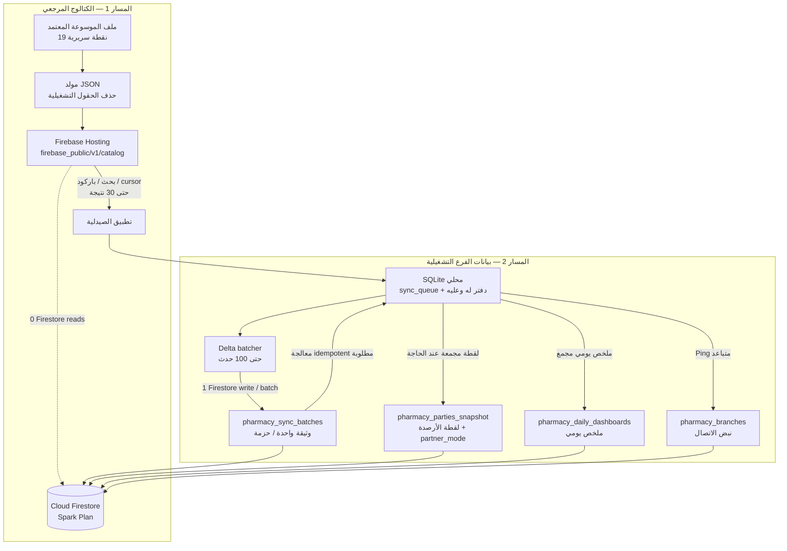

# معمارية مكتبة الأدوية المركزية — نبض الصيدلة

**الحالة:** تأسيس محلي للكتالوج منفذ ومختبر عبر CI؛ خادم الموسوعة المركزي لم يُنشر بعد.  
**الفرع:** `feature/central-medicine-catalog`  
**الفرع الأساس:** `feature/remove-demo-seed-data`

## 1. الهدف

تمكين كل صيدلية من اختيار الأصناف التي تتعامل معها فقط من موسوعة مركزية قد تصل إلى 100,000 صنف أو أكثر، دون تحميل الموسوعة كاملة إلى ذاكرة الواجهة أو إدخال أصناف تجريبية عند التثبيت.

تبقى قاعدة الصيدلية التشغيلية مستقلة، وتظل الفواتير والمخزون والتكاليف والأسعار والدفعات محلية وخاصة بالفرع.

## 2. المعمارية المعتمدة

1. **الموسوعة المركزية:** مصدر مرجعي للأدوية على خادم PostgreSQL مقترح، مع UUID عالمي ثابت وإصدارات ومصادر ومراجعات.
2. **واجهة API:** توفر البحث والصفحات والتفاصيل والتغييرات؛ لا ترسل جميع الأصناف في طلب واحد.
3. **ذاكرة SQLite المحلية:** تحفظ نتائج البحث/التفاصيل التي جلبها المستخدم فقط في `catalog_cache`.
4. **أدوية الصيدلية:** جدول `drugs` الحالي هو السجل التشغيلي الذي تعتمد عليه المبيعات والمشتريات والمخزون والوصفات والتقارير. أضيف إليه مرجع عالمي اختياري `catalog_uuid` وإصدار `catalog_version`.
5. **المخزون:** اختيار دواء من الموسوعة لا ينشئ دفعة أو حركة مخزون أو رصيداً. تضاف الكميات عبر الشراء أو الإدخال المخزني فقط.

## 3. قواعد لا يجوز خرقها

- لا تحميل 100 ألف سجل إلى Widgets أو Provider دفعة واحدة.
- لا نسخ الموسوعة السريرية كاملة إلى كل صيدلية تلقائياً.
- لا تخزين أسعار البيع/الشراء أو الرصيد أو المورد أو رقم التشغيلة في الكتالوج المركزي.
- تحديث الموسوعة لا يغير الأسعار أو الدفعات أو الحركات أو الفواتير التاريخية.
- لا حذف صنف له مراجع تشغيلية؛ تعطيله/إخفاؤه يحافظ على التاريخ.
- لا نشر معلومات سريرية غير موثقة على أنها نصيحة علاجية؛ يجب حفظ مصدرها وحالة مراجعتها وإصدارها.

## 4. البحث عند 100 ألف صنف

- طلبات البحث البعيد محدودة بحد أقصى 30 نتيجة للصفحة، مع cursor pagination.
- البحث بالباركود مسار exact match باستخدام `barcode`، وليس LIKE.
- لا تعرض التفاصيل السريرية في نتائج البحث؛ تُعرض فقط عند فتح الدواء. إذا لم تتضمن بيانات النتيجة الحالية معلومات سريرية، تعرض الواجهة أنها غير متاحة بدلاً من اختلاق معلومات. ما زال endpoint مستقل لجلب تفاصيل سريرية كاملة مطلوباً إذا كان API البحث يعيد ملخصات فقط.
- العميل المحلي يدعم FTS5 بعد اختباره وقت التشغيل، مع fallback إلى بحث LIKE آمن إذا لم يكن FTS5 متاحاً.
- ذاكرة البحث محدودة افتراضياً بـ10,000 نتيجة غير مختارة؛ لا تُحذف النتائج المرتبطة بأدوية مختارة في جدول `drugs`.
- استعلامات SQLite غير متزامنة، ولا تُحمّل قائمة الكتالوج كاملة إلى الذاكرة.

## 5. نموذج البيانات المحلي

### `catalog_cache`

يحفظ UUID وإصدار الكتالوج، الاسم العربي والإنجليزي والعلمي، المادة الفعالة، الشركة، الشكل والتركيز، الباركود، نص البحث، JSON الأصلي، المصدر وحالة المراجعة وتوقيت التخزين.

### `catalog_sync_state`

يحفظ آخر إصدار تمت مزامنته وETag وأوقات النجاح/الفشل ورسالة الخطأ.

### `drugs`

يحفظ بيانات الصيدلية التشغيلية الحالية، مع `catalog_uuid` و`catalog_version` الاختياريين. الفهرس الجزئي يمنع تكرار المرجع المركزي للصنف النشط داخل الفرع.

## 6. تنفيذ البحث المحلي والبعيد

الملفات التي أضيفت:

- `lib/data/models/catalog_drug_model.dart`: نموذج نتيجة الكتالوج والتحقق من UUID والإصدار والاسم، وتحويل البيانات إلى/من ذاكرة SQLite.
- `lib/data/services/central_catalog_api.dart`: عقد مصدر بيانات قابل للاستبدال، وعميل HTTP قابل لحقن عنوان الخادم وHeaders، مع timeout افتراضي 12 ثانية.
- `lib/data/repositories/catalog_search_repository.dart`: تنسيق البحث البعيد والذاكرة المحلية، exact barcode، FTS5 runtime probe، fallback، تخزين transaction، منع رجوع الإصدار، وتنظيف الذاكرة القديمة.

السلوك:

1. أقل من حرفين لا يرسل طلب بحث نصي.
2. يحد العميل حجم الصفحة إلى 30 حتى لو طلب المستدعي أكثر.
3. إذا كان هناك مصدر بعيد، يطلب النتائج ويحفظها محلياً.
4. عند فشل الشبكة يعيد النتائج المحلية المطابقة ويحدد `offlineFallback=true` مع سبب الخطأ.
5. إذا وصل إصدار قديم بعد إصدار أحدث، لا يستبدل الإصدار الأحدث.
6. تُخزن نتائج البحث فقط، ولا تُنشأ أدوية تشغيلية أو دفعات مخزون من البحث.

### عقد API المقترح

طلب نصي:

`GET /v1/catalog/search?q=amoxicillin&limit=30&cursor=...`

طلب باركود:

`GET /v1/catalog/search?barcode=6281000000001&limit=30`

شكل الاستجابة:

```json
{
  "items": [
    {
      "catalog_uuid": "global-uuid",
      "catalog_version": 1,
      "trade_name_ar": "اسم الدواء",
      "trade_name_en": "Trade name",
      "scientific_name": "Generic name",
      "active_ingredient_name": "Active ingredient",
      "barcode_international": "6281000000001",
      "search_text": "اسم الدواء trade name generic ingredient",
      "source_name": "Verified reference",
      "review_status": "REVIEWED"
    }
  ],
  "next_cursor": null
}
```

يسمح العميل أيضاً باستجابة JSON عبارة عن قائمة مباشرة. كل عنصر صحيح يجب أن يحتوي `catalog_uuid` و`catalog_version` موجباً و`trade_name_ar` غير فارغ. يحتفظ `payload_json` بكامل JSON الوارد لتفاصيل/حقول مستقبلية.

**لا يوجد حتى الآن عنوان API إنتاجي أو خادم منشور أو بيانات اعتماد.** لا تضع عنواناً وهمياً في التطبيق؛ يمرر `baseUri` عند إعداد الاتصال في مرحلة الخادم.

## 7. واجهة اختيار الدواء

- شاشة `lib/screens/drugs/central_medicine_picker_screen.dart` مرتبطة من شاشة الموسوعة.
- البحث التدريجي بتأخير 300ms، وإبطال منطقي للاستجابات القديمة، وحد أقصى 30 نتيجة في الصفحة.
- بطاقات نتائج البحث لا تعرض بيانات سريرية ولا زر إضافة؛ فتح البطاقة يعرض التفاصيل المتاحة من JSON الخاص بالكتالوج، بما فيها الحقول السريرية المعروفة ومصدرها وحالة مراجعتها.
- إذا لم تتوفر حقول سريرية في بيانات الموسوعة، تظهر رسالة صريحة بعدم توفرها. لا يتم توليد أو استنتاج بيانات طبية.
- زر «إضافة إلى صيدليتي» موجود داخل لوحة التفاصيل فقط. ينشئ سجل `drugs` محلياً عند ضغطه صراحة، مع `catalog_uuid` و`catalog_version`، وبأسعار وتكلفة ومخزون صفري؛ لا ينشئ دفعة أو حركة مخزون.

## 8. المراحل

| المرحلة | النطاق | الحالة |
|---|---|---|
| 0 | تدقيق الوضع وتثبيت المعمارية والتوثيق | مكتملة |
| 1 | هوية عالمية وذاكرة SQLite وترحيل آمن | مكتملة وCI أخضر |
| 2 | Repository والبحث المحلي/البعيد والـ cache | مكتملة وCI أخضر (Run 42420419008) |
| 3 | شاشة اختيار، debounce 300ms وصفحات 30، تفاصيل عند الفتح وإضافة صريحة بلا مخزون | منفذة؛ آخر تعديل ينتظر CI |
| 4 | API والخادم المركزي | لم تبدأ |
| 5 | مزامنة الإصدارات والتغييرات | لم تبدأ |
| 6 | حزمة اختيارية للعمل دون اتصال | لم تبدأ |
| 7 | اختبار أداء 100 ألف صنف وقياس الذاكرة | لم تبدأ |

## 9. حدود المرحلة الحالية

لا يوجد خادم مركزي PostgreSQL أو API منشور في المستودع. طبقة HTTP هنا عقد عميل جاهز للربط، ولا تعني أن الموسوعة المركزية متاحة فعلياً. لا تُستورد بيانات طبية قبل تحديد مصادر مرخصة ومراجعتها سريرياً.


## 9. Firebase Hosting Static Shards — Batch 1

يعمل العميل بوضع تلقائي افتراضي متوافق مع المسار الديناميكي السابق:
- يحاول أولاً `GET /v1/catalog/search?q=...&limit=30&cursor=...` أو `?barcode=...`.
- عند HTTP 404 فقط، ينتقل إلى الشظايا الساكنة. يمكن فرض وضع dynamic أو static عبر `CatalogEndpointMode`.
- exact barcode يطلب `/v1/catalog/barcodes/{barcode}.json`.
- البحث النصي يطلب `/v1/catalog/search/{prefix}.json`، حيث prefix أول حرفين مطبعين. الصفحة التالية تطلب `/v1/catalog/search/{next_cursor}.json`.
- عند كون الاستعلام أطول من حرفين، يطبق العميل مطابقة كل كلمات الاستعلام على حقول البحث المتاحة محلياً، ويعيد 30 نتيجة كحد أقصى.
- استجابة الشظية تحمل `catalog_version` و`etag` و`items` و`next_cursor`. ويحدث العميل `catalog_sync_state` ضمن `central_catalog` دون السماح لنسخة أقدم باستبدال الإصدار أو ETag الأحدث.

المولد `tools/build_firebase_central_catalog.py` يقرأ ملف JSON المرجعي الذي يمرر عبر `--input` (الافتراضي `merged_19points_drugs.json`) ويكتب:
- `manifest.json` مع الإصدار وETag وإحصاءات عدد الأدوية والباركود والبادئات.
- `barcodes/{barcode}.json` للباركود الرقمي بطول 8–14.
- `search/{prefix}.json` ثم `search/{prefix}_p2.json` وما بعدها، بحد 30 عنصراً لكل ملف.
- يزيل الحقول التشغيلية والمالية والمخزون والتشغيلات والدفعات والموردين والقيود وسجلات التدقيق بشكل recursive. لا يضيف أسعاراً أو أرصدة أو مخزوناً.

**حد نشر:** Firebase Hosting لم يُنشر بعد. كما أن ملف `merged_19points_drugs.json` غير موجود في الفرع عند تنفيذ Batch 1؛ لذلك لا يمكن بناء بيانات حقيقية أو التحقق من حجمها/توزيعها قبل توفير المصدر المرجعي. يجب مراجعة قائمة الحقول المحذوفة مع مخطط المصدر قبل النشر.


## 10. فصل مساري Firebase — Batch 2

تعتمد المنظومة مسارين مستقلين تماماً، ولا يجوز أن يصبح الكتالوج المرجعي مخزناً لبيانات الصيدلية التشغيلية:

### المسار الأول: الكتالوج المركزي — Firebase Hosting Static JSON

- الجذر المنشور: `firebase_public/`، والكتالوج تحت `/v1/catalog/`.
- البحث والباركود يقرآن ملفات JSON ثابتة؛ لا تُقرأ وثائق Firestore للبحث أو تفاصيل الأدوية، وبالتالي يستهلك هذا المسار **صفراً من قراءات Firestore**.
- العقد: `manifest.json`، و`search/{prefix}.json` وصفحات `search/{prefix}_pN.json)، و`barcodes/{barcode}.json`.
- الباركود exact match بطول 8–14 رقماً، والبحث النصي يستخدم بادئة مطبّعة عربية/إنجليزية وصفحات لا تتجاوز 30 عنصراً مع `next_cursor`.
- تتضمن الاستجابة `catalog_version` ووسم المحتوى `etag` داخل JSON. يرسل Firebase Hosting أيضاً ETag HTTP للملف الثابت؛ لا نضع قيمة ETag ثابتة يدوياً في ترويسة مخصصة حتى لا تتعارض مع ETag الذي يولده Hosting.
- بيانات الكتالوج عامة ومرجعية: لا أسعار شراء/بيع، ولا تكاليف، ولا مخزون، ولا كميات، ولا تشغيلات أو دفعات أو أرصدة أو موردين أو قيود فرع. لا يكتب هذا المسار أي بيانات إلى Firestore.

### المسار الثاني: بيانات الفرع — Cloud Firestore (Spark Plan)

المجموعات المقترحة:

| المجموعة | الوثيقة | الغرض |
|---|---|---|
| `pharmacy_branches` | `{branchId}` | تعريف الفرع ونبض الاتصال المرتبط بالإعداد 35 `sync.cloud` |
| `pharmacy_daily_dashboards` | `{branchId}_{YYYYMMDD}` | ملخص المالك اليومي؛ يستهدف قراءة واحدة للوثيقة عند فتح الملخص |
| `pharmacy_parties_snapshot` | `{branchId}` | لقطة دفتر «له وعليه» وحالة قفل توزيع الشركاء |
| `pharmacy_sync_batches` | `{branchId}/batches/{batchUuid}` | سجل حزم delta مضغوطة، كل حزمة حتى 100 حدث |

**تجميع الطابور:** يقرأ عامل المزامنة المحلي سجلات `sync_queue` المعلقة (`sync_status = 0`) بترتيب ثابت، ويجمع حتى 100 سجل من المجالات المفعّلة (المبيعات، تشغيلات `batches_fefo`، المشتريات والبونص، القرارات السريرية، و`audit_logs`) في وثيقة واحدة. بعد تأكيد نجاح كتابة وثيقة الدفعة فقط، يعلّم العامل السجلات المقابلة بأنها أُرسلت. عند الفشل تبقى معلقة لإعادة المحاولة؛ ويجب أن تكون المعالجة في الطرف المستقبل idempotent باستخدام `batchUuid` ومعرف الحدث العالمي، لمنع التكرار. هذه الدفعة توثق العقد وتضيف قواعد Firestore؛ **لا تدّعي أنها نفذت بعد محرك رفع/استقبال المزامنة أو ربط الإعداد 35**.

**ميزانية Spark:** يهدف التجميع إلى تقليل الكتابات إلى كتابة واحدة لكل 100 حدث بدلاً من كتابة لكل حدث. وتهدف لوحة المالك إلى قراءة وثيقة واحدة لكل تحميل، مع استخدام اللقطة بدلاً من قراءة دفاتر الأطراف كاملة. هذه أهداف تشغيلية وليست حصصاً مضمونة؛ يجب مراقبة الاستخدام الفعلي، وتجنب polling قصير، واستخدام ping متباعد أو عند تغير الحالة فقط. حدود الخطة المجانية وسياسات التسعير قابلة للتغيير ويجب مراجعتها في Firebase Console قبل الإطلاق.

### دفتر «له وعليه» وقفل الشركاء

- تستخدم اللقطات واللوحة تسميات العرض: `له`، `عليه`، `المتبقي له`، `المتبقي عليه`، `مسدَّد`. لا تُعرض مصطلحات محاسبية بديلة في عقد المزامنة أو واجهة المالك.
- يثبت `partner_mode` على `shares` أو `percentage` عند إنشاء لقطة الفرع. قواعد Firestore تمنع تغييره في التحديثات اللاحقة؛ يجب أن يظل قفل SQLite المحلي وقواعد البيانات المحلية هما الحماية الأساسية أيضاً.
- يجب أن تُحسب اللقطة من دفتر الفرع المحلي الموثوق، لا من تجميعات عميل غير موثوقة. يفضّل أن يصدرها خادم موثوق أو عامل موثق مع صلاحية فرع محددة.
- Firestore Rules لا تستبدل التحقق المحاسبي داخل الخدمات؛ فهي تتحقق من نطاق الفرع وصحة قيمة `partner_mode` وشكل حزمة الأحداث وحجمها فقط.

### مخطط المسارين



### قواعد Firebase المنشورة في المستودع

- `firebase/firestore.rules`: تتطلب هوية Firebase موثقة وcustom claim باسم `branch_id`، وclaim باسم `branch_role` بقيمة `owner` أو `manager` للعمليات الإدارية؛ لا تثق بمعرف الفرع القادم من payload وحده. تحديث نبض الفرع محصور في حقول heartbeat المسموح بها.
- الوصول للفرع مقيد بمعرف الفرع الموجود في claim. حذف وثائق الفرع واللقطات واللوحات ممنوع من العميل.
- حزم المزامنة append-only: يسمح بإنشائها فقط، مع `events` قائمة لا تتجاوز 100 عنصراً ووجود `batch_uuid` المطابق لمعرف الوثيقة؛ يمنع update/delete.
- `partner_mode` لا يقبل إلا `shares` أو `percentage`، ويمنع تغييره بعد الإنشاء.
- `catalog_meta` مغلق في Firestore لأن بيانات الكتالوج منشورة عبر Hosting؛ ذلك يحافظ على صفر قراءات Firestore للكتالوج.
- `firebase/firebase.json` يحدد Hosting public directory إلى `firebase_public`، ويضيف Cache-Control وCORS لمسار `/v1/catalog/**`. ETag HTTP يترك لـFirebase Hosting، وETag المحتوى موجود في JSON.

### متطلبات قبل تفعيل المزامنة الحية

1. إعداد Firebase Authentication وإصدار custom claim موثوق `branch_id` بعد التحقق من اشتراك وهوية الفرع.
2. عامل Firestore REST موجود في `lib/data/services/firestore_sync_worker.dart`: يرفع queue كوثيقة append-only بحد 100 حدث وبصمة ثابتة، ثم يسحب وثائق الفرع للـInbox. يتطلب ID token وcustom claim موثوقاً؛ لم يربط بعد بمزود Firebase Authentication أو جدولة التشغيل.
3. لا تُعلّم صفوف SQLite كـSYNCED ولا عناصر queue كـDONE إلا بعد تأكيد كتابة Firestore؛ إعادة المحاولة تستخدم batch UUID ثابتاً وتتحقق من البصمة.
4. أضيف `sync_inbox` و`sync_inbox_batches` في schema v14، ومعالج `FirestoreInboxProcessor` يسجل event UUID وبصمة المحتوى ويطبق التغيير ضمن معاملة واحدة، ويربط FK عبر UUID الأب ويؤجل السجلات التي لم تصل تبعياتها. اختبارات idempotency وFK والتعارض المحلي مضافة؛ ما زال Emulator واختبار انقطاع الشبكة end-to-end مطلوبين.
5. تحديد سياسة ping، الاحتفاظ بالدفعات، حذف/أرشفة البيانات، التشفير والنسخ الاحتياطي ومراقبة ميزانية Spark قبل الإنتاج.
6. مراجعة صلاحيات الوصول إلى سجلات المبيعات والقرارات السريرية وaudit_logs؛ لا تضع بيانات مرضى حساسة في payload غير مشفر أو دون أساس قانوني/موافقة مناسبة.
